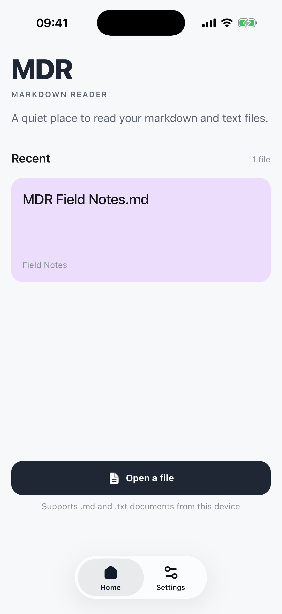
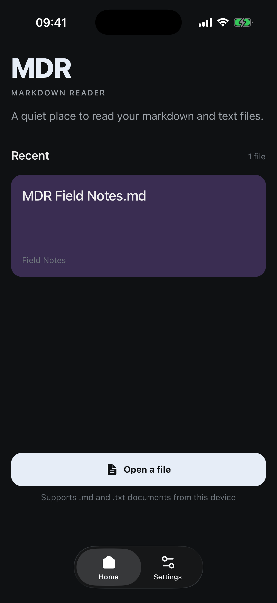
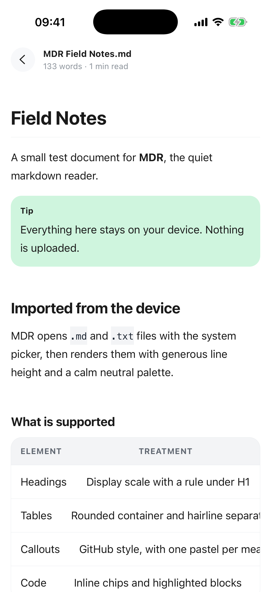
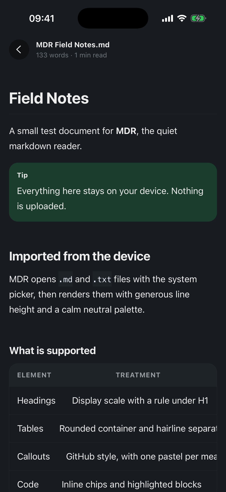
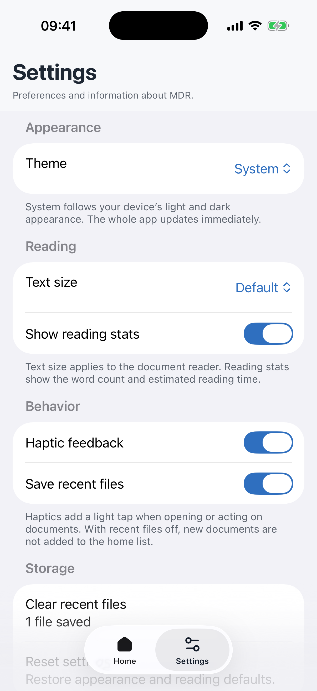
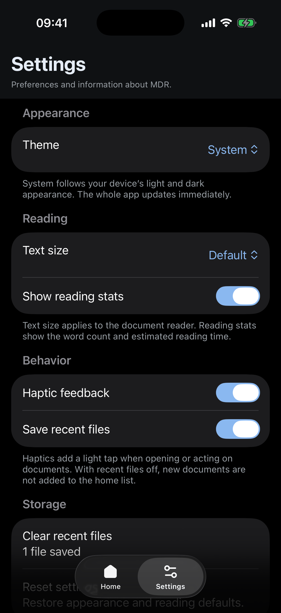

# MDR

A quiet Markdown reader for iOS, Android and the web, built with Expo.

<p align="center">
  
</p>

<p align="center">
  
  
</p>
<p align="center">
  
  
</p>
<p align="center">
  
  
</p>

<p align="center">Screenshots captured on an iPhone 17 simulator in light and dark appearance.</p>

## Features

- Opens `.md` and `.txt` files from the device with the system picker
- Native settings screen with a persisted System / Light / Dark theme, applied app-wide
- Reader text size, reading stats, haptic feedback and recent-file preferences
- Recent files grid with a stable pastel color per file, stored locally
- Clear recent files and reset settings from the Storage section
- GitHub style callouts: NOTE, TIP, IMPORTANT, WARNING and CAUTION
- Tables with tinted headers, hairline rows and horizontal scroll for wide content
- Syntax highlighted code blocks with a language chip
- Calm neutral palette with pastels reserved for meaning, in light and dark
- Word count and estimated reading time in the reader header
- Documents stay on the device, nothing is uploaded

## Markdown support

| Element | Treatment |
| :--- | :--- |
| Headings | Display scale with a rule under H1 |
| Tables | Rounded container, uppercase header row, hairline separators, column alignment |
| Callouts | `> [!NOTE]` maps to blue, `[!TIP]` green, `[!IMPORTANT]` purple, `[!WARNING]` yellow, `[!CAUTION]` red |
| Code | Inline code chips and highlighted fenced blocks via `lowlight` |
| Lists | Unordered and ordered with muted markers |
| Quotes | Muted text with a soft left rule |
| Links | Accent color, opened in an in-app browser on native |

## Design system

The look is calm: a neutral canvas, one dark ink color, and five pastel meaning colors. Tokens live in `src/constants/theme.ts`.

- Cards are flat with no borders or shadows. Only floating panels get a soft shadow.
- Cards use a large title and a small muted footer, for example a file name and its first line.
- The reader keeps generous line height and stays within a 680 point content width.

## Getting started

Install dependencies and start the dev server:

```bash
bun install
bunx expo start
```

Then press `a` for Android, `i` for iOS or `w` for the web, or scan the QR code with a development build.

## Commands

```bash
bunx expo start          # start the dev server
bunx expo start -c       # start with a cleared Metro cache
bunx expo lint           # lint
bunx tsc --noEmit        # typecheck
bunx expo-doctor         # diagnose dependency and config issues
```

## Local Android build

The `Makefile` wraps the local Android workflow. It expects JDK 17, Android Studio with the SDK installed, Bun, and an AVD.

```bash
make setup               # verify the toolchain and install required SDK packages
make emulator            # boot the configured AVD and wait for Android
make android             # generate android/, build, install, start Metro
make start               # Metro only after the first native build
make launch              # launch the installed app on the emulator
make apk                 # installable release APK in dist/mdr-release.apk
make release             # release build installed on the connected device
make help                # list every target
```

Override the default AVD with `make emulator AVD=Medium_Phone_API_37.0`. The generated `android/` directory is ignored by git — regenerate it with `make prebuild` after changing native configuration.

## Project structure

```
src/
  app/          Expo Router routes (tabs, settings, viewer)
  components/   MDRender, CodeBlock and themed primitives
  constants/    design tokens and theme
  hooks/        color scheme, haptics and markdown styles
  lib/          file helpers, recents storage and settings model
  providers/    persisted settings and theme resolution
assets/         icons and screenshots
```

## Tech stack

- Expo Router and React Native
- `@expo/ui` for the native settings form (`Form`, `Toggle` and `Picker` via SwiftUI and Jetpack Compose)
- `react-native-markdown-renderer` with custom table, callout and code rules
- `lowlight` for syntax highlighting
- yooo-native for dialogs and toasts
- AsyncStorage for the recent files list and settings
